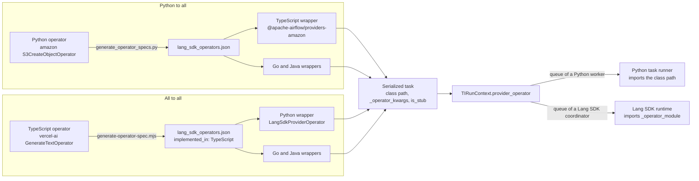
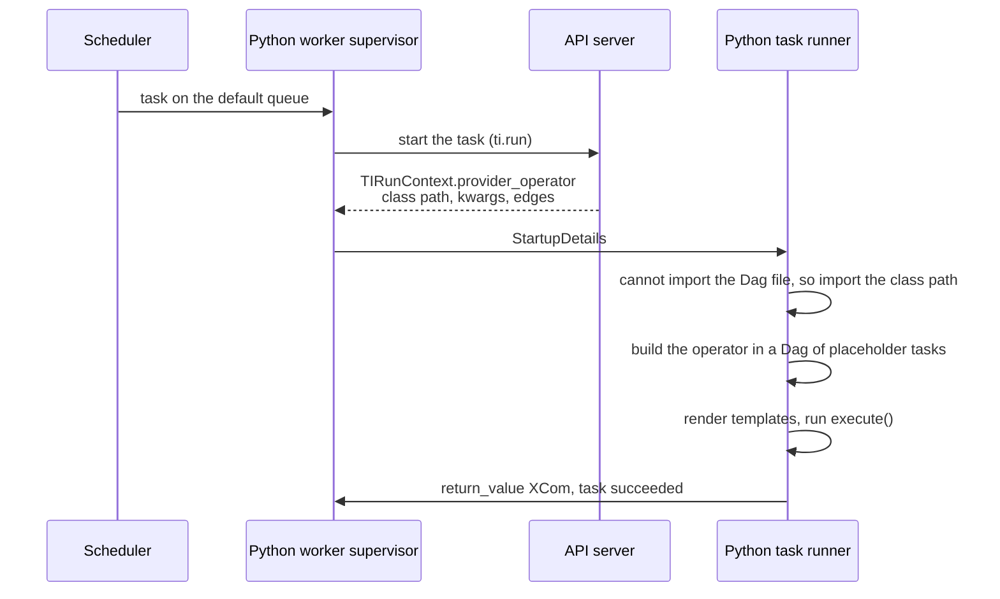
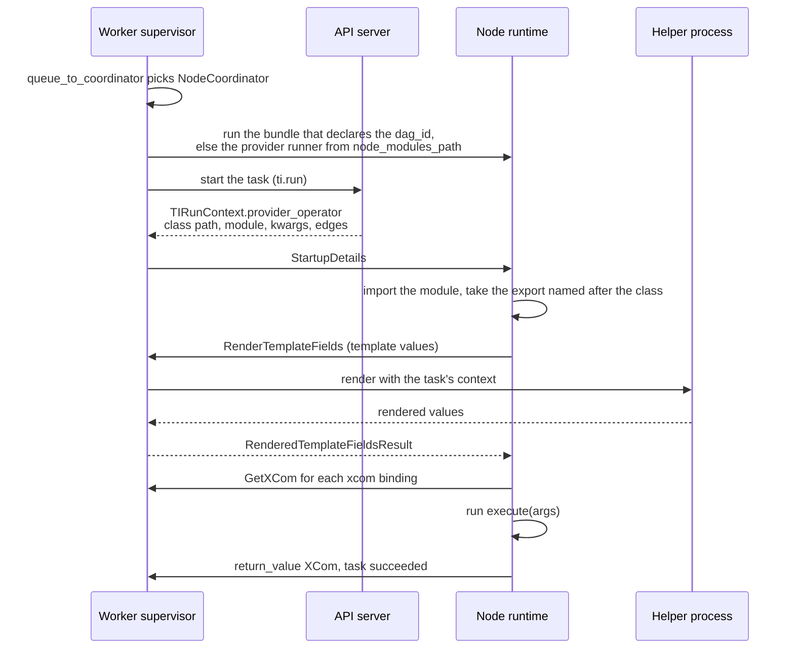

<!--
 Licensed to the Apache Software Foundation (ASF) under one
 or more contributor license agreements.  See the NOTICE file
 distributed with this work for additional information
 regarding copyright ownership.  The ASF licenses this file
 to you under the Apache License, Version 2.0 (the
 "License"); you may not use this file except in compliance
 with the License.  You may obtain a copy of the License at

   http://www.apache.org/licenses/LICENSE-2.0

 Unless required by applicable law or agreed to in writing,
 software distributed under the License is distributed on an
 "AS IS" BASIS, WITHOUT WARRANTIES OR CONDITIONS OF ANY
 KIND, either express or implied.  See the License for the
 specific language governing permissions and limitations
 under the License.
 -->

# ADR-0018: Provider Operators Across SDKs

## Status

Proposed.

## Context

[ADR-0009](0009-provider-operators-as-generated-dsl.md) lets a Dag written in a Lang SDK use a provider operator implemented in Python. Some integrations go the other way: the library they need exists only in another ecosystem, such as the Vercel AI SDK for TypeScript. This ADR covers both directions with one mechanism.

- **Python to all.** The operator is implemented in Python, and a Dag written in a Lang SDK uses it. Example: a TypeScript Dag that writes a report to S3 with the amazon provider.
- **All to all.** The operator is implemented in a Lang SDK, and a Dag written in Python or in any Lang SDK uses it. Example: a Python Dag that asks a model for a summary through a TypeScript provider built on the Vercel AI SDK.

A Dag author sees the same thing in both cases: a typed operator class in their own language. The two cases differ in where the operator is implemented, and so in which runtime builds and runs it.

## Decision

1. **An operator is identified by its Python class path in every SDK**, for example `airflow.providers.amazon.aws.operators.s3.S3CreateObjectOperator`. The class path is what the scheduler, the UI and every runtime see.
2. **One generated spec per provider is the source of truth for every wrapper.** `providers/<provider>/_generated/lang_sdk_operators.json` describes each operator's parameters, template fields and class attributes. It is generated from the implementation: from the Python constructors for a Python provider, and from the Lang SDK code for any other. Every SDK generates its typed wrapper package from it.
3. **A wrapper emits JSON and nothing else.** The serialized task carries the class path, the constructor arguments as `_operator_kwargs`, and `is_stub`. When a Lang SDK implements the operator, it also carries `_operator_module`, the module to import.
4. **The arguments are argument bindings.** `_operator_kwargs` is a list of the bindings of [ADR-0007](0007-taskflow-across-language-boundary.md) with plain JSON values, so no SDK decodes Airflow's Python serialization format.
5. **The task gets its operator in the run context.** When the task starts, the Execution API fills `TIRunContext.provider_operator` with the class path, the module, the arguments and the Dag's edges. No extra request is made.
6. **The task's queue picks the runtime.** `[sdk] queue_to_coordinator` routes a queue to a Lang SDK coordinator. A task of a Lang SDK implemented operator that lands on a Python worker fails with a message that names the queue setting.
7. **Templates always render in Python.** A Python worker renders them as it does for any task. A Lang SDK runtime sends its template values to the supervisor, which renders them in the task's helper process.

## Overview



The authoring side differs only in where the spec comes from. The run side differs only in which runtime builds the operator.

## Python to all

The amazon provider is implemented in Python. A TypeScript Dag uses it through the generated wrapper:

```ts
import { Dag } from "@apache-airflow/ts-sdk";
import { S3CreateObjectOperator } from "@apache-airflow/providers-amazon/aws/operators/s3";

const dag = new Dag("publish_report", { queue: "typescript" });
const report = dag.task("build_report", async () => JSON.stringify({ orders: 3, total: 120 }))();
dag.task(
  "write_report",
  S3CreateObjectOperator({ s3Bucket: "reports", s3Key: "{{ ds }}/report.json", data: report }),
)();
```

`build_report` runs in Node. `write_report` runs on a Python worker: a provider task does not take the Dag's queue.

**Authoring.** The question is how a worker builds the operator and calls `execute`, and the answer is the class path and the constructor arguments. The spec is generated from the Python constructors, as [ADR-0009](0009-provider-operators-as-generated-dsl.md) describes. Each SDK generates a typed wrapper from it, and the wrapper writes the arguments under the Python parameter names:

```json
{
  "task_id": "write_report",
  "task_type": "S3CreateObjectOperator",
  "_task_module": "airflow.providers.amazon.aws.operators.s3",
  "is_stub": true,
  "_operator_kwargs": [
    {"name": "s3_bucket", "kind": "literal", "value": "reports"},
    {"name": "s3_key", "kind": "literal", "value": "{{ ds }}/report.json"},
    {"name": "data", "kind": "xcom", "task_id": "build_report"}
  ]
}
```

**Execution.** The Python worker builds the operator from the run context and runs it like any Python task:



The task runner turns each `xcom` binding into an `XComArg` of a placeholder task with the same id. The placeholder tasks keep the Dag's task ids and edges, which is what an operator reads of its Dag, such as the tasks to skip.

## All to all

A TypeScript provider built on the Vercel AI SDK implements the operator. `execute` is what makes the definition an implementation rather than a wrapper:

```ts
import { generateText } from "ai";
import { openai } from "@ai-sdk/openai";
import { defineProviderOperator, type Templated } from "@apache-airflow/ts-sdk/provider";

export interface GenerateTextOperatorArgs {
  readonly model: string;
  readonly prompt: Templated<string>;
}

export const GenerateTextOperator = defineProviderOperator<GenerateTextOperatorArgs, string>({
  module: "airflow.providers.vercel.ai.operators.text",
  className: "GenerateTextOperator",
  implementationModule: "@apache-airflow/providers-vercel-ai/operators/text",
  templateFields: ["prompt"],
  params: { model: { name: "model", required: true }, prompt: { name: "prompt", required: true } },
  async execute({ model, prompt }) {
    const { text } = await generateText({ model: openai(model), prompt });
    return text;
  },
});
```

A Python Dag uses the generated wrapper and sends the task to the TypeScript runtime with its queue:

```python
from airflow.providers.vercel.ai.operators.text import GenerateTextOperator

with DAG("summarize_orders", schedule="@daily"):
    GenerateTextOperator(
        task_id="summarize",
        model="gpt-4o-mini",
        prompt="Summarize the orders of {{ ds }}.",
        queue="typescript",
    )
```

**Authoring.** The flow is reversed. The spec is generated from the TypeScript code, with `implemented_in` naming the runtime and `implementation_module` naming the module that exports the operator. The Python wrapper generated from it is a `LangSdkProviderOperator` subclass with no `execute` of its own:

```python
class GenerateTextOperator(LangSdkProviderOperator):
    template_fields = ("prompt",)
    operator_params = ("model", "prompt")
    implemented_in = ("TypeScript",)
    implementation_module = "@apache-airflow/providers-vercel-ai/operators/text"
```

It writes the same task shape, plus the module:

```json
{
  "task_id": "summarize",
  "task_type": "GenerateTextOperator",
  "_task_module": "airflow.providers.vercel.ai.operators.text",
  "_operator_module": "@apache-airflow/providers-vercel-ai/operators/text",
  "is_stub": true,
  "_operator_kwargs": [
    {"name": "model", "kind": "literal", "value": "gpt-4o-mini"},
    {"name": "prompt", "kind": "literal", "value": "Summarize the orders of {{ ds }}."}
  ]
}
```

A TypeScript Dag that uses `GenerateTextOperator` directly writes the same task.

**Execution.** The queue sends the task to the Node coordinator, and the runtime imports the implementation:



- **Finding the implementation.** When the bundle declares the task, as for a TypeScript Dag's own task, the implementation is already packed in it. Otherwise the runtime imports `_operator_module` and checks that the export implements the class path. Both ways share one task path for failure, retry and the `return_value` XCom.
- **The provider runner.** `@apache-airflow/ts-sdk` ships a runner that serves an empty bundle, so every task it runs is imported. `NodeCoordinator` starts it when no bundle declares the Dag and its `node_modules_path` is set. A deployment installs the SDK and the provider packages into that directory, for example with `npm install --prefix /opt/airflow/ts @apache-airflow/ts-sdk @apache-airflow/providers-vercel-ai`. The provider package then resolves from the runner and shares its copy of the SDK.
- **Rendering.** The helper process is the one that runs the XCom backend for the task, started on the first call that needs it. It builds the template context from the task's start-up details and renders with the Task SDK. The supervisor keeps the rendered values as the task's rendered fields, so the UI shows them as it does for a Python task. An `xcom` binding is pulled by the runtime, not rendered.

## Comparison

| | Python to all | All to all |
| --- | --- | --- |
| Example | TypeScript Dag, amazon `S3CreateObjectOperator` | Python Dag, vercel-ai `GenerateTextOperator` |
| Spec generated from | Python constructors | Lang SDK implementation |
| Python package | The operator itself | A generated `LangSdkProviderOperator` wrapper |
| Other SDKs | Generated wrappers | Generated wrappers, or the implementation itself |
| Serialized task | Class path, `_operator_kwargs`, `is_stub` | The same, plus `_operator_module` |
| Queue | One a Python worker serves | One routed to the implementing SDK's coordinator |
| Who builds the operator | Python task runner, from the class path | Lang SDK runtime, from its bundle or `_operator_module` |
| Templates | Rendered by the task runner | Rendered by the supervisor's helper process |

## Consequences

- **Every SDK writes one task shape.** Any runtime that implements a class path can run a task from a Dag in any language, and adding an SDK takes one generator that reads any spec rather than one per pair of languages.
- **Authors set the queue.** The wrapper cannot know which workers a deployment runs, so the author routes the task. A Lang SDK implemented operator that reaches a Python worker fails before it does any work.
- **A wrapper must match the deployed provider.** As in ADR-0009, version skew between a wrapper and the installed provider warns and does not block.
- **Templates in a Lang SDK runtime render with less context.** Dag params, `template_ext` files and user-defined macros do not reach the helper process. The run's details, `var`, `conn`, `xcom_pull` and macro plugins work.
- **A provider task cannot be mapped**, in either direction.
- **A Python Dag that a bundle declares runs in that bundle.** If the Dag also has `@task.stub` handlers, its Lang SDK provider tasks run in that bundle instead of the provider runner, so the bundle must resolve the provider package and share its copy of the SDK. Keeping such operators in Dags that no bundle declares avoids this.

## Go and Java

Both follow the same rules, keyed by the Python class path. Go cannot load code at run time, so a provider host executable imports the provider modules, which register their implementations in `init()`. Java finds implementations on the classpath through `ServiceLoader`. In both, the arguments decode from the bindings into a typed struct or record.

## Appendix: Implementation Notes

The TypeScript SDK implements both directions. `apache-airflow-providers-localfile` (`CreateFileOperator`, `WriteFileOperator`, `HasFileOperator`, `DeleteFileOperator`) is the first provider implemented in TypeScript. The vercel-ai provider above is an illustration.

- **Spec.** `scripts/ci/lang_sdk_providers/generate_operator_specs.py` writes the spec of a Python provider. `ts-sdk/scripts/generate-operator-spec.mjs` writes the spec of a TypeScript provider from the definitions that have an `execute`, and from the `<ClassName>Args` interface of each. Both follow `airflow-core/src/airflow/lang_sdk_provider_operators.schema.json`.
- **Wrappers.** `ts-sdk/scripts/generate-providers.mjs` writes the TypeScript wrappers and skips TypeScript-implemented specs. `scripts/ci/lang_sdk_providers/generate_python_wrappers.py` writes the Python wrappers. Unit tests fail when committed wrappers are not what the specs generate.
- **Values.** A datetime is an ISO 8601 string with `value_schema` format `date-time`. A timedelta is a number of seconds with format `duration-seconds`. A set or a tuple is a list. A task's result is an `xcom` binding only when it is the whole argument; a result inside a list or a dict fails when the Dag is serialized. An unset optional argument is left out, so the implementation applies its own default.
- **Run context.** The API server fills `TIRunContext.provider_operator` inside the check it already makes for stub tasks, which is why provider tasks are marked `is_stub`.
- **Rendering messages.** `RenderTemplateFields` and `RenderedTemplateFieldsResult` are internal to the protocol between a runtime and its supervisor.
- **Node.** The provider runner is `airflow-ts-provider-runner`. The coordinator reads its supervisor schema version from `airflow.supervisorSchemaVersion` in the SDK's `package.json`. Without `node_modules_path`, a task that no bundle declares fails as before.
