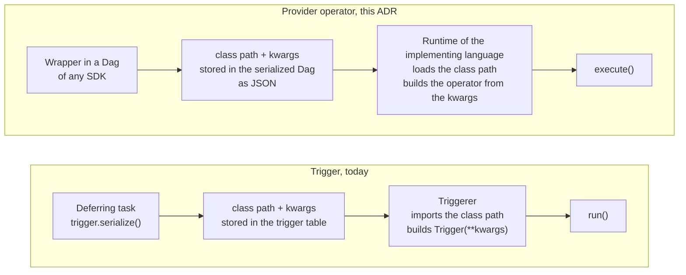
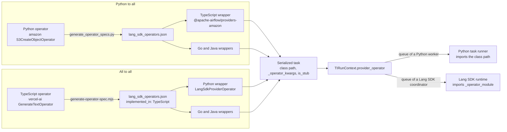
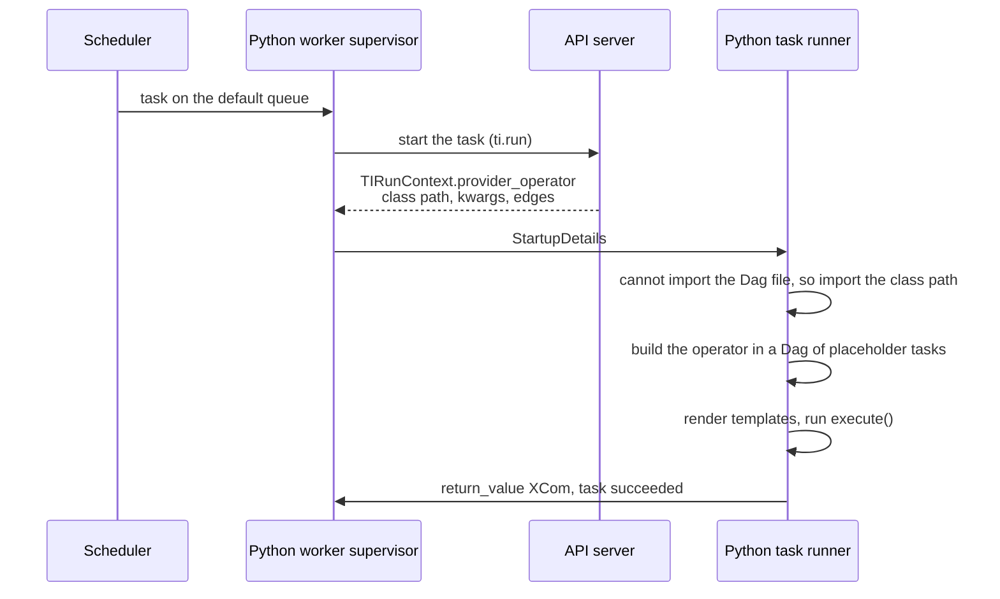
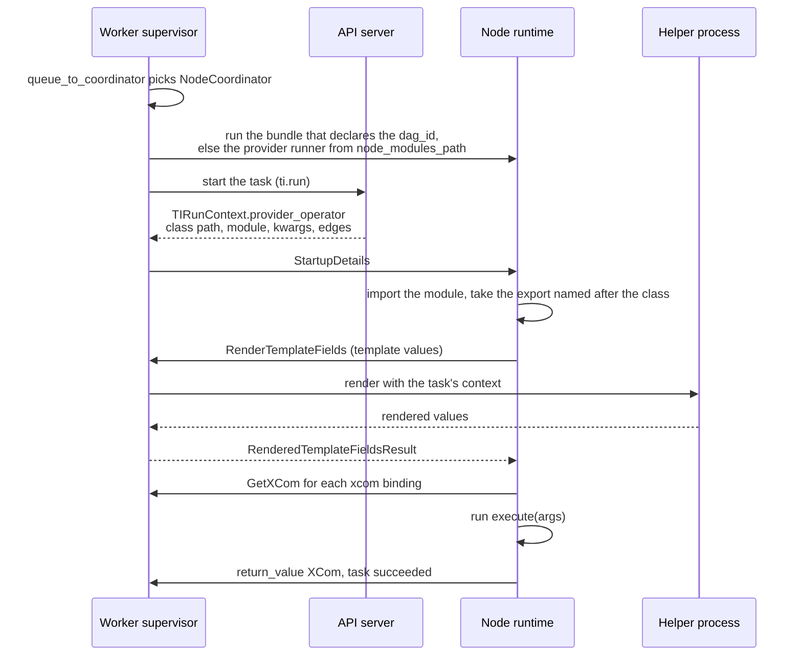
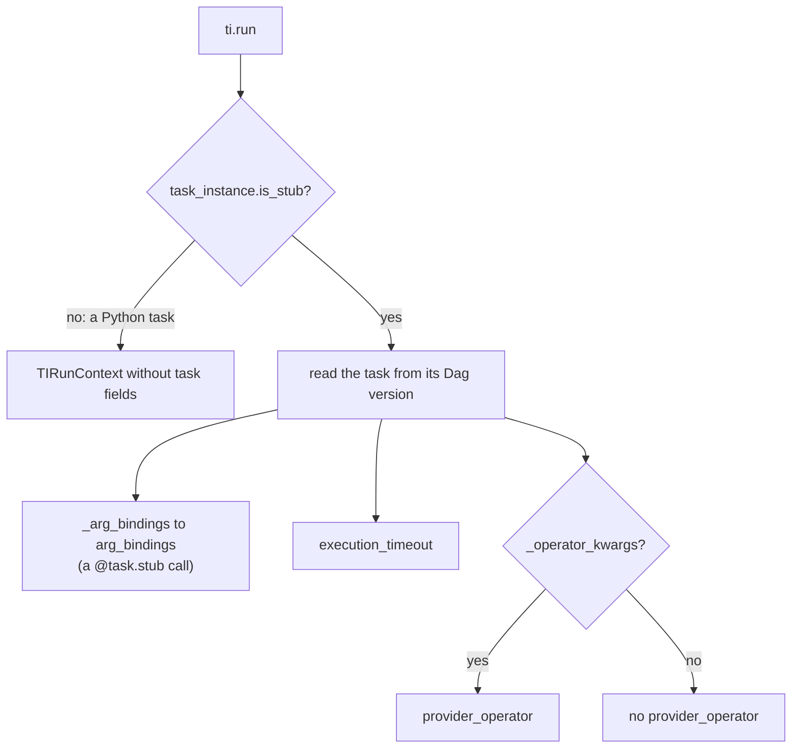
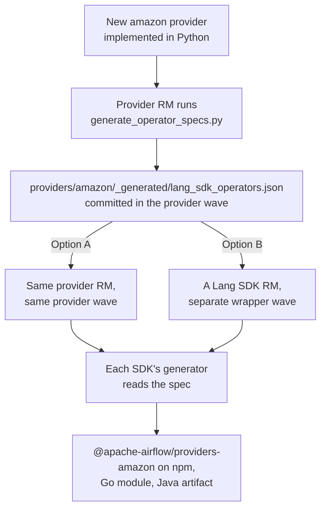

<!--
 Licensed to the Apache Software Foundation (ASF) under one
 or more contributor license agreements.  See the NOTICE file
 distributed with this work for additional information
 regarding copyright ownership.  The ASF licenses this file
 to you under the Apache License, Version 2.0 (the
 "License"); you may not use this file except in compliance
 with the License.  You may obtain a copy of the License at

   http://www.apache.org/licenses/LICENSE-2.0

 Unless required by applicable law or agreed to in writing,
 software distributed under the License is distributed on an
 "AS IS" BASIS, WITHOUT WARRANTIES OR CONDITIONS OF ANY
 KIND, either express or implied.  See the License for the
 specific language governing permissions and limitations
 under the License.
 -->

# ADR-0018: Provider Operators Across SDKs

## Status

Proposed.

## Context

[ADR-0009](0009-provider-operators-as-generated-dsl.md) lets a Dag written in a Lang SDK use a provider operator implemented in Python. Some integrations go the other way: the library they need exists only in another ecosystem, such as the Vercel AI SDK for TypeScript. This ADR covers both directions with one mechanism.

- **Python to all.** The operator is implemented in Python, and a Dag written in a Lang SDK uses it. Example: a TypeScript Dag that writes a report to S3 with the amazon provider.
- **All to all.** The operator is implemented in a Lang SDK, and a Dag written in Python or in any Lang SDK uses it. Example: a Python Dag that asks a model for a summary through a TypeScript provider built on the Vercel AI SDK.

Both directions rest on one fact: a worker needs only two things to build a provider operator, its class path and the keyword arguments of its constructor. The Triggerer already works this way. A trigger serializes to its class path and kwargs, and the Triggerer rebuilds it from them without the Dag file. Provider operator arguments are limited to JSON-serializable values, so any SDK can write the pair and any runtime can read it. A cross-language provider only has to deliver that pair to a runtime of the language that implements the operator.



A Dag author sees the same thing in both cases: a typed operator class in their own language. The two cases differ in where the operator is implemented, and so in which runtime builds and runs it.

## Decision

1. **An operator has one name and one location.** Its name is the Python class path, for example `airflow.providers.amazon.aws.operators.s3.S3CreateObjectOperator`, which the scheduler, the UI and the Python wrapper use, and which a runtime checks the implementation against. Its location depends on the runtime that implements it: a Python worker imports the class path itself, and a Lang SDK runtime loads `_operator_module`, written in that SDK's own terms, such as an npm module specifier.
2. **One generated spec per provider is the source of truth for every wrapper.** `providers/<provider>/_generated/lang_sdk_operators.json` describes each operator's parameters, template fields and class attributes. It is generated from the implementation: from the Python constructors for a Python provider, and from the Lang SDK code for any other. Every SDK generates its typed wrapper package from it.
3. **A wrapper emits JSON in the argument-binding format, not in the core serialization format.** The serialized task carries the class path, the constructor arguments as `_operator_kwargs`, and `is_stub`. `_operator_kwargs` is a list of the argument bindings of [ADR-0007](0007-taskflow-across-language-boundary.md), whose values are plain JSON rather than Airflow's `{__type, __var}` encoding. Operator arguments are limited to JSON-serializable values, so no SDK runtime has to reimplement the core serializer to read them. When a Lang SDK implements the operator, the task also carries `_operator_module`, the module to import.
4. **The task gets its operator in the run context.** Provider tasks are stubs, so the run endpoint reads their serialized task and fills `TIRunContext.provider_operator` with the class path, the module, the arguments and the Dag's edges. No extra request is made.
5. **The task's queue picks the runtime.** `[sdk] queue_to_coordinator` routes a queue to a Lang SDK coordinator. A task of a Lang SDK implemented operator that lands on a Python worker fails with a message that names the queue setting.
6. **A Lang SDK runtime loads an operator it was not built with.** The coordinator starts a generic runtime when no Dag bundle declares the task. The runtime starts knowing nothing about the operator; it learns which one to run from `TIRunContext.provider_operator` in its start-up details, then loads `_operator_module` from a location the administrator configures.
7. **Templates always render in Python.** A Python worker renders them as it does for any task. A Lang SDK runtime sends its template values to the supervisor, which renders them in the task's helper process.

## Overview



The authoring side differs only in where the spec comes from. The run side differs only in which runtime builds the operator.

## Python to all

The amazon provider is implemented in Python. A TypeScript Dag uses it through the generated wrapper:

```ts
import { Dag } from "@apache-airflow/ts-sdk";
import { S3CreateObjectOperator } from "@apache-airflow/providers-amazon/aws/operators/s3";

const dag = new Dag("publish_report", { queue: "typescript" });
const report = dag.task("build_report", async () => JSON.stringify({ orders: 3, total: 120 }))();
dag.task(
  "write_report",
  S3CreateObjectOperator({ s3Bucket: "reports", s3Key: "{{ ds }}/report.json", data: report }),
)();
```

`build_report` runs in Node. `write_report` runs on a Python worker.

> **Note:** The provider task needs no queue of its own. A Python-implemented provider task does not inherit the Dag's `queue`, so it gets `[operators] default_queue` (`default`). No coordinator is mapped to that queue in `[sdk] queue_to_coordinator`, so a Python worker runs it. Set a task queue only to send it to a different pool of Python workers.

**Authoring.** The question is how a worker builds the operator and calls `execute`, and the answer is the class path and the constructor arguments. The spec is generated from the Python constructors, as [ADR-0009](0009-provider-operators-as-generated-dsl.md) describes. Each SDK generates a typed wrapper from it, and the wrapper writes the arguments under the Python parameter names:

```json
{
  "task_id": "write_report",
  "task_type": "S3CreateObjectOperator",
  "_task_module": "airflow.providers.amazon.aws.operators.s3",
  "is_stub": true,
  "_operator_kwargs": [
    {"name": "s3_bucket", "kind": "literal", "value": "reports"},
    {"name": "s3_key", "kind": "literal", "value": "{{ ds }}/report.json"},
    {"name": "data", "kind": "xcom", "task_id": "build_report"}
  ]
}
```

**Execution.** The Python worker builds the operator from the run context and runs it like any Python task:



The task runner turns each `xcom` binding into an `XComArg` of a placeholder task with the same id. The placeholder tasks keep the Dag's task ids and edges, which is what an operator reads of its Dag, such as the tasks to skip.

## All to all

A TypeScript provider built on the Vercel AI SDK implements the operator. `execute` is what makes the definition an implementation rather than a wrapper:

```ts
import { generateText } from "ai";
import { openai } from "@ai-sdk/openai";
import { defineProviderOperator, type Templated } from "@apache-airflow/ts-sdk/provider";

export interface GenerateTextOperatorArgs {
  readonly model: string;
  readonly prompt: Templated<string>;
}

export const GenerateTextOperator = defineProviderOperator<GenerateTextOperatorArgs, string>({
  module: "airflow.providers.vercel.ai.operators.text",
  className: "GenerateTextOperator",
  implementationModule: "@apache-airflow/providers-vercel-ai/operators/text",
  templateFields: ["prompt"],
  params: { model: { name: "model", required: true }, prompt: { name: "prompt", required: true } },
  async execute({ model, prompt }) {
    const { text } = await generateText({ model: openai(model), prompt });
    return text;
  },
});
```

A Python Dag uses the generated wrapper and sends the task to the TypeScript runtime with its queue:

```python
from airflow.providers.vercel.ai.operators.text import GenerateTextOperator

with DAG("summarize_orders", schedule="@daily"):
    GenerateTextOperator(
        task_id="summarize",
        model="gpt-4o-mini",
        prompt="Summarize the orders of {{ ds }}.",
        queue="typescript",
    )
```

**Authoring.** The flow is reversed. The spec is generated from the TypeScript code, with `implemented_in` naming the runtime and `implementation_module` naming the module that exports the operator. The Python wrapper generated from it is a `LangSdkProviderOperator` subclass with no `execute` of its own:

```python
class GenerateTextOperator(LangSdkProviderOperator):
    template_fields = ("prompt",)
    operator_params = ("model", "prompt")
    implemented_in = ("TypeScript",)
    implementation_module = "@apache-airflow/providers-vercel-ai/operators/text"
```

It writes the same task shape, plus the module:

```json
{
  "task_id": "summarize",
  "task_type": "GenerateTextOperator",
  "_task_module": "airflow.providers.vercel.ai.operators.text",
  "_operator_module": "@apache-airflow/providers-vercel-ai/operators/text",
  "is_stub": true,
  "_operator_kwargs": [
    {"name": "model", "kind": "literal", "value": "gpt-4o-mini"},
    {"name": "prompt", "kind": "literal", "value": "Summarize the orders of {{ ds }}."}
  ]
}
```

A TypeScript Dag that uses `GenerateTextOperator` directly writes the same task.

Python's role changes in this direction. The Python package of the provider holds only wrappers: the Dag processor serializes a wrapper like any operator, and `LangSdkProviderOperator` makes the serializer write `_operator_kwargs` and `_operator_module` instead of running anything. [Serialized task and run context](#serialized-task-and-run-context) shows the schema and how the run endpoint reads it.

**Launching a generic runtime.** The coordinator chooses which program to start before the task starts. The supervisor launches the runtime first and only then calls `ti.run`, because that call carries the new process's id, so the coordinator never sees `provider_operator`. It decides from the Dag alone:

- A Dag bundle declares the task's `dag_id`, as for a TypeScript Dag: the coordinator runs that bundle's artifact, `node <bundle>/dags/report.min.mjs --comm=<host:port> --logs=<host:port>`.
- No bundle declares it, as for the Python Dag above, and `node_modules_path` is set: the coordinator runs the provider runner, `node <node_modules_path>/@apache-airflow/ts-sdk/dist/coordinator/provider-runner.js --comm=<host:port> --logs=<host:port>`. The runner serves an empty bundle, so it runs any provider operator and nothing else.

The second case is why each SDK needs a generic runtime. A Python Dag's file is Python, not a `.min.mjs` artifact, so there is nothing of the Dag for Node to run. The same holds for any pair of languages, such as a Go Dag using an operator implemented in Java: the Java coordinator cannot run the Go Dag's binary, so it needs a Java runtime that holds no Dag.

The administrator installs the SDK and the provider packages into one directory on the workers, usually in the worker image, and points the coordinator at it:

```bash
npm install --prefix /opt/airflow/ts @apache-airflow/ts-sdk @apache-airflow/providers-vercel-ai
```

```ini
[sdk]
coordinators = {
  "ts": {
    "classpath": "airflow.sdk.coordinators.node.NodeCoordinator",
    "kwargs": {"node_modules_path": "/opt/airflow/ts/node_modules"}
  }
}
queue_to_coordinator = {"typescript": "ts"}
```

Node does not use `NODE_PATH` to resolve an `import()`, so the location must be configured. Because the runner itself lives in that `node_modules`, the provider package resolves from it and shares its copy of the SDK.

**Execution.**



- **Finding the implementation.** The runtime knows a task is a provider operator from `ti_context.provider_operator` alone. When the bundle declares the task, as for a TypeScript Dag's own task, the implementation is already packed in it. Otherwise the runtime runs `await import(module)`, takes the export named after the class, and checks that it implements the class path. Both ways share one task path for failure, retry and the `return_value` XCom.
- **Rendering.** The helper process is the one that runs the XCom backend for the task, started on the first call that needs it. It builds the template context from the task's start-up details and renders with the Task SDK. The supervisor keeps the rendered values as the task's rendered fields, so the UI shows them as it does for a Python task. An `xcom` binding is pulled by the runtime, not rendered.

## Serialized task and run context

Both directions store the same fields on the serialized task. The serialized Dag schema (`airflow-core/src/airflow/serialization/schema.json`) adds two of them, and reuses the argument binding that `@task.stub` already has:

```json
"arg_binding": {
  "type": "object",
  "properties": {
    "name": {"type": "string"},
    "kind": {"enum": ["xcom", "literal"]},
    "task_id": {"type": "string"},
    "value": {},
    "from_default": {"type": "boolean"},
    "value_schema": {"type": "object"}
  },
  "required": ["name", "kind"]
},
"_operator_kwargs": {
  "$comment": "Constructor arguments of the task_type class in _task_module, in parameter order",
  "type": "array",
  "items": {"$ref": "#/definitions/arg_binding"}
},
"_operator_module": {
  "$comment": "Module of the Lang SDK that implements the operator and exports it under the class name",
  "type": "string"
}
```

| Field | Written by | Meaning |
| --- | --- | --- |
| `task_type`, `_task_module` | Every wrapper | The Python class path, which the scheduler and the UI already read |
| `is_stub` | Every wrapper | The task's runtime cannot build the task from a Dag file, so the API server sends what it needs |
| `_operator_kwargs` | Every wrapper | The constructor arguments as argument bindings with plain JSON values |
| `_operator_module` | Wrappers of a Lang SDK implemented operator | What the implementing runtime imports |

**The `is_stub` gate.** `is_stub` was introduced for `@task.stub` tasks, whose runtime cannot parse the Python Dag file. A provider task has the same need: whichever runtime runs it cannot import the file that declared it. When the scheduler creates a task instance, it copies the serialized task's `is_stub` into `task_instance.is_stub`. The run endpoint checks that column before anything else, so a plain Python task never loads its serialized Dag. A stub task loads it once, and the endpoint fills every field a foreign runtime needs from it.



**How the run endpoint reads the operator.** It reads the task from the serialized Dag of the task instance's Dag version, so a task always runs the arguments of the version its run started with. When the task has `_operator_kwargs`, it builds the container:

- `classpath` is `_task_module` and `task_type` joined by a dot.
- `kwargs` is `_operator_kwargs` as stored.
- `module` is `_operator_module`, when present.
- `downstream_task_ids` maps every task of the Dag to its direct downstream tasks, which an operator needs to skip or to find upstream results.

It validates the container against `TIProviderOperator` and fails the call with a server error naming `invalid_provider_operator` when the stored arguments are not valid bindings. A client on an older Execution API version does not receive the field. For the Python Dag above, the runtime receives:

```json
"provider_operator": {
  "classpath": "airflow.providers.vercel.ai.operators.text.GenerateTextOperator",
  "module": "@apache-airflow/providers-vercel-ai/operators/text",
  "kwargs": [
    {"name": "model", "kind": "literal", "value": "gpt-4o-mini"},
    {"name": "prompt", "kind": "literal", "value": "Summarize the orders of {{ ds }}."}
  ],
  "downstream_task_ids": {"summarize": []}
}
```

## Comparison

| | Python to all | All to all |
| --- | --- | --- |
| Example | TypeScript Dag, amazon `S3CreateObjectOperator` | Python Dag, vercel-ai `GenerateTextOperator` |
| Spec generated from | Python constructors | Lang SDK implementation |
| Python package | The operator itself | A generated `LangSdkProviderOperator` wrapper |
| Other SDKs | Generated wrappers | Generated wrappers, or the implementation itself |
| Serialized task | Class path, `_operator_kwargs`, `is_stub` | The same, plus `_operator_module` |
| Queue | One a Python worker serves | One routed to the implementing SDK's coordinator |
| Runtime started | The Python task runner | The Dag's bundle, or the SDK's generic runtime |
| Who builds the operator | Python task runner, from the class path | Lang SDK runtime, from its bundle or `_operator_module` |
| Templates | Rendered by the task runner | Rendered by the supervisor's helper process |

## Releasing wrapper packages

A provider release produces the spec, and a wrapper release turns the spec into one package per SDK. The release manager (RM) of a provider wave runs the spec generator, and the spec is committed with the provider's source. Who releases the wrapper packages from it is open, with two options:



- **Option A: same wave.** The provider RM also generates and publishes every wrapper package in the provider wave. Wrappers never lag behind their provider, but the provider RM needs the Node, Go and Java toolchains and publishing access to every package registry, and each wave republishes wrappers even when no operator signature changed.
- **Option B: separate wrapper waves.** The provider RM only regenerates and commits the spec, which a prek hook already keeps current. A Lang SDK RM releases wrapper packages from the committed specs on its own cadence, such as one wrapper wave every two or three provider waves, or an ad-hoc wave when a provider adds an operator users are waiting for. The provider release process stays as it is, and spec changes from several waves ship together. It would amend ADR-0009's decision 8, which ships wrappers on the provider's own release cadence.

Either way a wrapper package is versioned as the provider it was generated from, as [ADR-0009](0009-provider-operators-as-generated-dsl.md) decides, and the SDK's own version stays separate. A provider's major version bump does not force a wrapper upgrade: the wrapper only describes constructor signatures, so users upgrade it when the signature of an operator they use changes. Skew between the wrapper in the Dag and the provider installed on the worker warns and does not block.

The same choice applies in the other direction. For a provider implemented in a Lang SDK, the spec comes from the implementation's release, and the Python wrapper is the package released from it.

## Dynamic loading in Go and Java

The TypeScript SDK can load an operator it was not built with because Node imports modules at run time. Go and Java need the same three pieces, each in their own way:

1. **A generic runtime** that the coordinator starts when no Dag bundle declares the task.
2. **A way to load an implementation by `_operator_module`** at run time.
3. **An install location** that the administrator fills with provider packages and gives to the coordinator.

| | TypeScript | Go | Java |
| --- | --- | --- | --- |
| Loads code at run time | Yes, `import()` | No | Yes, class loaders |
| Generic runtime | Provider runner in `@apache-airflow/ts-sdk` | Open: a provider host the administrator builds, or a go-plugin host in the SDK | A runner main class in the SDK JAR |
| `_operator_module` | npm module specifier | Go import path, or a plugin executable name | Fully qualified class name |
| Administrator installs | `npm install --prefix <dir>` | `go build` of the host, or plugin executables into a directory | Provider JARs into a directory |
| Coordinator setting | `node_modules_path` | A path to the host, or to the plugin directory | A path to the JAR directory |

**Go.** Go links everything into one binary at build time, so Go needs a design of its own. There are three candidates.

- **The standard `plugin` package: rejected.** It works only on Linux and macOS, and a plugin must be built with the same toolchain and the same versions of every shared dependency as the program that loads it. Provider packages released on their own cadence cannot meet that.
- **A provider host built by the administrator.** The administrator builds a small `main` package that blank-imports the provider modules the deployment needs. Each module registers its implementations in `init()`, keyed by the Python class path, and the host serves an empty Dag bundle. Discovery is a map lookup inside one process. Adding a provider means rebuilding the host.
- **[hashicorp/go-plugin](https://github.com/hashicorp/go-plugin).** The Go SDK ships a generic host, and each provider ships its own plugin executable. The host starts the plugin as a subprocess and calls it over gRPC, so plugins and host can be built and released separately. Adding a provider means copying its executable into a directory.

With the provider host, a provider module and the host look like this:

```go
// Provider module: github.com/apache/airflow/go-providers/example/operators
func init() {
    provider.Register("airflow.providers.example.operators.text.GenerateTextOperator", generateText)
}

// Host, built by the administrator
package main

import (
    "github.com/apache/airflow/go-sdk/provider"
    _ "github.com/apache/airflow/go-providers/example/operators"
)

func main() { provider.ServeHost() }
```

With go-plugin, the provider serves its operators and the host dispenses them by the module name:

```go
// Provider executable
func main() {
    plugin.Serve(&plugin.ServeConfig{
        HandshakeConfig: provider.Handshake,
        Plugins: map[string]plugin.Plugin{
            "operators": &provider.OperatorsPlugin{Impl: provider.Operators{
                "airflow.providers.example.operators.text.GenerateTextOperator": generateText,
            }},
        },
        GRPCServer: plugin.DefaultGRPCServer,
    })
}

// Generic host in the Go SDK, after it reads TIRunContext.provider_operator
client := plugin.NewClient(&plugin.ClientConfig{
    HandshakeConfig:  provider.Handshake,
    Plugins:          map[string]plugin.Plugin{"operators": &provider.OperatorsPlugin{}},
    Cmd:              exec.Command(filepath.Join(pluginDir, path.Base(operator.Module))),
    AllowedProtocols: []plugin.Protocol{plugin.ProtocolGRPC},
})
rpc, _ := client.Client()
raw, _ := rpc.Dispense("operators")
result, err := raw.(provider.Operators).Execute(ctx, operator.Classpath, operator.Kwargs)
```

`provider.Register`, `provider.ServeHost`, `provider.Handshake` and `provider.OperatorsPlugin` would be new Go SDK APIs; `plugin.*` is go-plugin's API. For go-plugin, discovery maps `_operator_module` to an executable in the configured directory, and the host can ask each plugin for the class paths it serves. The cost is a second process boundary: the operator's calls back to Airflow, such as reading a connection or pushing an XCom, must cross from the plugin to the host, which go-plugin supports through its gRPC broker. The provider host keeps everything in one process at the price of a rebuild per provider change. This ADR leaves the choice open.

**Java.** The JVM loads classes at run time, so Java can follow TypeScript closely. The SDK JAR gains a runner main class that serves an empty bundle. The administrator copies the provider JARs into a directory, for example with Maven's `dependency:copy`, and the coordinator adds that directory to the runner's classpath. `_operator_module` is the implementation's class name, which the runner loads with `Class.forName` and checks against the class path. `ServiceLoader` could list the installed implementations for error messages.

In both SDKs the arguments decode from the bindings into a typed struct or record, the same as for a Dag declared in that SDK. Neither is implemented yet, and the coordinator settings are named here only to show the shape.

## Consequences

- **Every SDK writes one task shape.** Any runtime that implements a class path can run a task from a Dag in any language, and adding an SDK takes one generator that reads any spec rather than one per pair of languages.
- **No runtime decodes core serialization.** Limiting operator arguments to JSON is what lets a wrapper write argument bindings instead of Airflow's Python encoding. An operator whose required argument is not JSON gets no wrapper, as in ADR-0009.
- **Authors set the queue.** The wrapper cannot know which workers a deployment runs, so the author routes the task. A Lang SDK implemented operator that reaches a Python worker fails before it does any work.
- **Administrators install implementations.** A provider implemented in a Lang SDK needs its package on every worker that serves its queue, in the location the coordinator is configured with.
- **Wrapper and provider versions may drift.** As in ADR-0009, skew between the wrapper in the Dag and the provider installed on the worker warns and does not block. It fails a task only when the signatures disagree at run time, for example when the wrapper passes an argument the installed operator no longer accepts.
- **Templates in a Lang SDK runtime render with less context, for now.** Dag params, `template_ext` files and user-defined macros do not reach the helper process yet. The run's details, `var`, `conn`, `xcom_pull` and macro plugins work. Nothing prevents the rest: the run context could carry the params, and the serialized task could carry the template extensions. That is follow-up work.
- **A wrapper task cannot be mapped yet.** A Python operator in a Python Dag maps as before, because the worker imports the Dag file and expands it itself. A wrapper has no Dag file to import: its runtime gets one fixed set of arguments in the run context, and the serializer rejects a mapped wrapper. Mapping it means sending the arguments of one map index, as [ADR-0016](0016-mapped-tasks-across-lang-sdks.md) does for stub tasks. That is follow-up work.
- **The coordinator picks the artifact by Dag, not by task.** Take a Python Dag `etl` with a `@task.stub` task whose handler lives in the TypeScript bundle `etl.min.mjs`, and a `GenerateTextOperator` task on the same queue. The bundle declares `etl`, so the coordinator runs `etl.min.mjs` for both tasks, and the generic runtime never starts. The provider task then runs only if the bundle itself imports `@apache-airflow/providers-vercel-ai`. Until the coordinator matches tasks as well as Dags, which the bundle metadata already allows since it lists the handled task ids per Dag, such an operator belongs in a Dag that no bundle declares, or in a bundle that imports its package.

## Appendix: Implementation Notes

The TypeScript SDK implements both directions. `apache-airflow-providers-localfile` (`CreateFileOperator`, `WriteFileOperator`, `HasFileOperator`, `DeleteFileOperator`) is the first provider implemented in TypeScript. The vercel-ai provider above is an illustration.

- **Spec.** `scripts/ci/lang_sdk_providers/generate_operator_specs.py` writes the spec of a Python provider. `ts-sdk/scripts/generate-operator-spec.mjs` writes the spec of a TypeScript provider from the definitions that have an `execute`, and from the `<ClassName>Args` interface of each. Both follow `airflow-core/src/airflow/lang_sdk_provider_operators.schema.json`.
- **Wrappers.** `ts-sdk/scripts/generate-providers.mjs` writes the TypeScript wrappers and skips TypeScript-implemented specs. `scripts/ci/lang_sdk_providers/generate_python_wrappers.py` writes the Python wrappers. Unit tests fail when committed wrappers are not what the specs generate.
- **Values.** A datetime is an ISO 8601 string with `value_schema` format `date-time`. A timedelta is a number of seconds with format `duration-seconds`. A set or a tuple is a list. A task's result is an `xcom` binding only when it is the whole argument; a result inside a list or a dict fails when the Dag is serialized. An unset optional argument is left out, so the implementation applies its own default.
- **Run endpoint.** `get_provider_operator` in `airflow-core/src/airflow/api_fastapi/execution_api/services/task_instances.py` builds the container, and `AddProviderOperatorToTIRunContext` in the `2027-02-28` Execution API version adds the field.
- **Rendering messages.** `RenderTemplateFields` and `RenderedTemplateFieldsResult` are internal to the protocol between a runtime and its supervisor.
- **Node.** The provider runner is `airflow-ts-provider-runner`. The coordinator reads its supervisor schema version from `airflow.supervisorSchemaVersion` in the SDK's `package.json`. Without `node_modules_path`, a task that no bundle declares fails as before.
