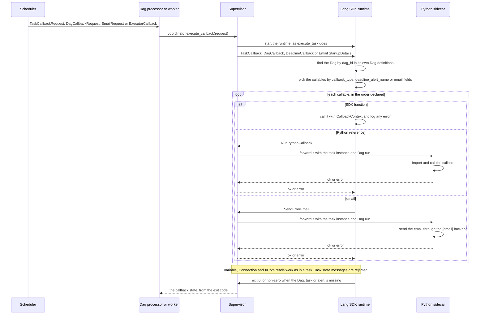
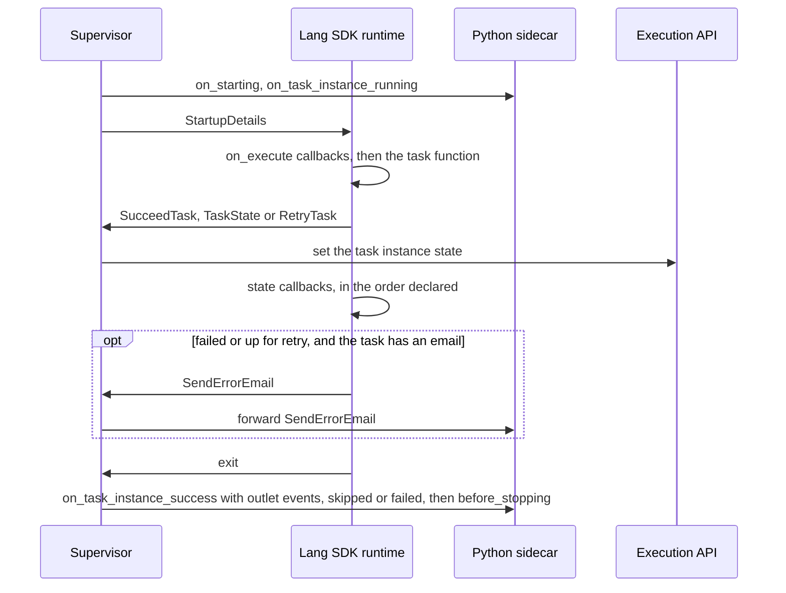
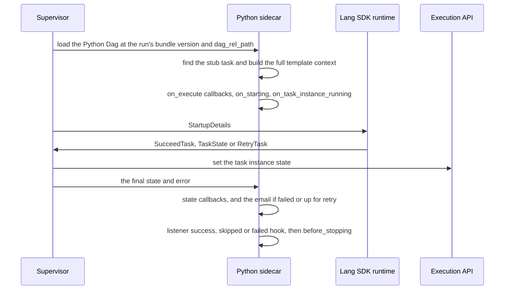
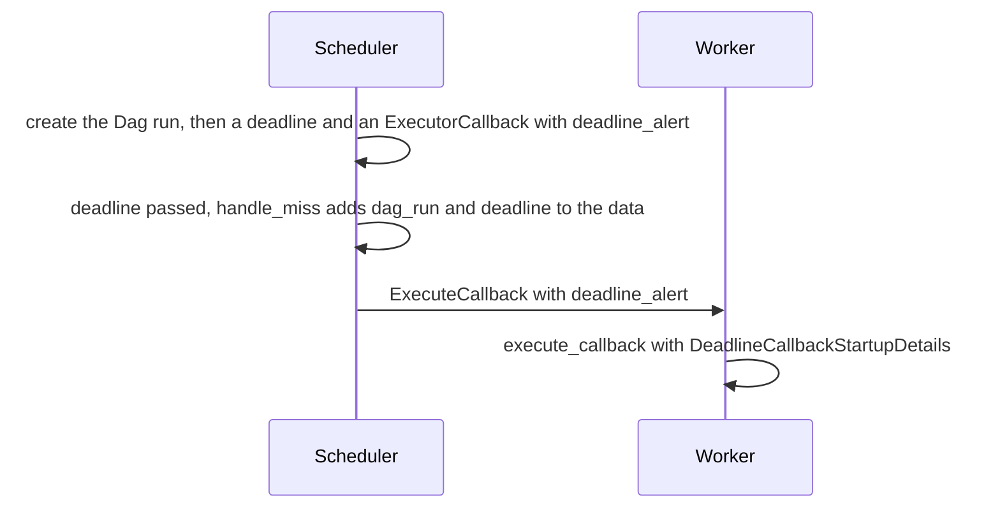

<!--
 Licensed to the Apache Software Foundation (ASF) under one
 or more contributor license agreements.  See the NOTICE file
 distributed with this work for additional information
 regarding copyright ownership.  The ASF licenses this file
 to you under the Apache License, Version 2.0 (the
 "License"); you may not use this file except in compliance
 with the License.  You may obtain a copy of the License at

   http://www.apache.org/licenses/LICENSE-2.0

 Unless required by applicable law or agreed to in writing,
 software distributed under the License is distributed on an
 "AS IS" BASIS, WITHOUT WARRANTIES OR CONDITIONS OF ANY
 KIND, either express or implied.  See the License for the
 specific language governing permissions and limitations
 under the License.
 -->

# ADR-0020: Callbacks, Deadline Alerts and Listeners Across Lang SDKs

## Status

Proposed.

## Context

A Lang SDK Dag has no callbacks today. No SDK writes the `has_on_*_callback` flags, the Dag
processor manager [drops][manager-drop] every callback request for a file a Lang SDK importer
claims, and [#76303], which routes Dag processor callbacks to executors, fails them for a
Lang SDK Dag. A stub TaskHandler's callbacks fire only when the Dag processor runs them, since the
Python task runner's [`finalize()`][finalize] never runs for it. Task instance listener hooks and
failure and retry emails never fire for a Lang SDK task for the same reason. Deadline alerts cannot
be authored in a Lang SDK.

This ADR fixes the contract every SDK shares. Each SDK records its own spelling in its own ADR:
[TypeScript](../../../ts-sdk/adr/0005-callbacks-and-deadline-alerts-authoring-interface.md),
[Go](../../../go-sdk/adr/0011-callbacks-and-deadline-alerts-authoring-interface.md) and
[Java](../../../java-sdk/adr/0005-callbacks-and-deadline-alerts-authoring-interface.md).

## Decision

1. **A callback is an SDK function or a Python reference.** A Python reference is
   `python.callbackRef(path, kwargs)` from the `python` module that [ADR-0019][adr-0019], assets and
   timetables across Lang SDKs, adds. A callback list can mix both and runs in the order declared.
   An exception in a callback is logged and swallowed, as in Python.
2. **An SDK writes only the existing callback flags.** It sets `has_on_success_callback` and
   `has_on_failure_callback` on the Dag and
   `has_on_{execute,success,failure,retry,skipped}_callback` on a task, since the scheduler creates
   a callback request only when the flag is set. No new serialized field is added. The callables
   stay in the runtime, which loads them from its own Dag definition. A stub TaskHandler's callables
   stay in its Python Dag file.
3. **A coordinator launches a callback the way it launches a task.**
   [`BaseCoordinator`][basecoordinator] keeps `execute_task` and gains `execute_callback`. Both
   start the runtime with the same process, comms channel and Python sidecar; only the first message
   differs. Each callback request has its own startup message, all sharing a base, as the Schemas
   section shows. A task callback uses the coordinator of the task instance's queue. A Dag or
   deadline callback uses the coordinator whose Dag importer claims the Dag file.
4. **The runtime runs a task's callbacks when the task ends.** A task ends when the runtime reports
   its final state. A task is interrupted when its runtime stops before that, because it crashed,
   was killed or ran out of memory; the scheduler finds it through a heartbeat timeout or an
   executor event and sets the state itself. `on_execute_callback` runs before the task function.
   The state callbacks run after the runtime reports the final state, as Python's
   [`finalize()`][finalize] does. For a Python reference the runtime sends `RunPythonCallback` to the
   supervisor, which adds the task instance and Dag run it already holds and forwards it to the
   Python sidecar. The sidecar imports and calls the callable, so no user code runs in the
   supervisor.
5. **Every other callback goes through `execute_callback`.** For an interrupted task, and for Dag
   success and failure, the scheduler sends the same requests it sends for a Python Dag. Both the
   Dag processor (routing off) and the worker (routing on, `dag_attribute`) call `execute_callback`
   for a Lang SDK Dag instead of dropping or failing the request. The runtime reads the callback
   context through the Execution API, as [#76303] does for Python.
6. **The Python sidecar runs a stub TaskHandler's callbacks.** The sidecar loads the Python Dag at
   the run's bundle version and `dag_rel_path`, as [#76303]'s `dag_attribute_callbacks` does, finds
   the stub task and runs its callbacks with the full template context: `on_execute_callback` before
   the runtime starts, the state callbacks after it reports. Callbacks for an interrupted task and
   Dag callbacks are unchanged, since the Dag file is Python.
7. **A Python reference in a Lang SDK Dag gets the context of its task instance and Dag run.** The
   sidecar has no Dag or task definition to render from, so the context holds `ti`, `dag_run`,
   `run_id`, `logical_date`, `ds`, `ts` and their variants, `data_interval_start`,
   `data_interval_end`, `var`, `conn`, `exception` and `reason`, but no `task`, `dag` or `params`.
   An SDK function gets the SDK's `CallbackContext`: the Dag run, the task instance for a task
   callback, the error for a failure or retry callback, the reason for a Dag callback, the deadline
   for a deadline callback, and the source.
8. **A deadline alert takes a built-in reference or a Python reference.** The built-in references
   are Dag run logical date, Dag run queued at, fixed datetime and average runtime. A custom
   reference is `python.deadlineReferenceRef(path, data)`, where `path` names a class a plugin
   registers in [`deadline_references`][deadline_references] and `data` is what its
   `deserialize_reference()` reads. The Lang SDK Dag processor rebuilds the reference with that
   class and stores what [`encode_deadline_reference`][encode_deadline_reference] writes, so the
   stored form matches a Python Dag's. An unregistered class is an import error.
9. **Both sync and async deadline callbacks are supported.** A sync callback is an SDK function or
   `python.callbackRef`. An async callback is `python.asyncCallbackRef(path, kwargs, queue)`, which
   runs as a trigger in the triggerer, so it must be Python, and every SDK rejects an SDK function
   there at build time. A Python reference serializes as the existing [`SyncCallback`][synccallback]
   or [`AsyncCallback`][asynccallback], and runs as it does for a Python Dag.
10. **The alert's name identifies an SDK function used as a deadline callback.** The alert must have
    a name unique in its Dag. Its callback serializes as a new `DeadlineAlertCallback`
    (`{kwargs, executor}`), which [`create_from_sdk_def`][create_from_sdk_def] turns into an
    `ExecutorCallback` with the new fetch method `deadline_alert` and
    `data = {dag_id, deadline_alert_name, kwargs, executor}`. The scheduler queues it like an
    `import_path` callback, outside [#76303]'s routing rules for `dag_attribute`. The worker calls
    `execute_callback`, and the runtime runs the alert's function.
11. **Listeners stay Python.** An SDK has no listener API. For a Lang SDK task the supervisor fires
    the task instance hooks (`on_starting`, `on_task_instance_running`, `on_task_instance_success`,
    `on_task_instance_skipped`, `on_task_instance_failed`, `before_stopping`) in the Python sidecar,
    with a [`RuntimeTaskInstance`][runtimetaskinstance] whose task is a placeholder carrying the
    task's ids and queue. On success it also passes the outlet events from `SucceedTask`. For a stub
    TaskHandler the task is the stub from the Python Dag. Dag run, asset and import error hooks
    already fire in the scheduler, API server and Dag processor.
12. **The Python sidecar sends failure and retry emails.** Every SDK adds a task `email` field that
    takes one address or a list, serialized under the `email` key as Python writes it, and writes
    `email_on_failure` and `email_on_retry` only when `email` is set, as Python does. The scheduler
    then sends an [`EmailRequest`][emailrequest] for an interrupted task as it does for a Python
    task, and it goes through `execute_callback` like the other callbacks. When a task ends as
    failed or up for retry, or an `EmailRequest` reaches the runtime, the runtime sends
    `SendErrorEmail` to the supervisor, which forwards it to the Python sidecar. The sidecar sends
    it through [`_send_error_email_notification`][_send_error_email_notification] with the context of
    decision 7, so the `[email]` backend and templates apply as for a Python task. For a stub
    TaskHandler the sidecar reads the fields from the stub task.
13. **Some features stay unsupported for now**: an SDK function as an async deadline callback, and a
    listener written in a Lang SDK.

## Schemas

The supervisor schema adds these models, and each SDK regenerates them. The startup messages map
one to one to the requests `execute_callback` receives.

```python
class BaseCallbackStartupDetails(BaseModel):
    dag_rel_path: str
    bundle_info: BundleInfo
    start_date: datetime
    dag_id: str
    run_id: str
    sentry_integration: str


class TaskCallbackStartupDetails(BaseCallbackStartupDetails):  # TaskCallbackRequest
    type: Literal["TaskCallbackStartupDetails"] = "TaskCallbackStartupDetails"
    ti: TaskInstance
    ti_context: TIRunContext
    callback_type: Literal[
        "on_execute_callback",
        "on_success_callback",
        "on_failure_callback",
        "on_retry_callback",
        "on_skipped_callback",
    ]
    error: str | None = None


class DagCallbackStartupDetails(BaseCallbackStartupDetails):  # DagCallbackRequest
    type: Literal["DagCallbackStartupDetails"] = "DagCallbackStartupDetails"
    dag_run: DagRun
    last_ti: TaskInstance | None = None
    callback_type: Literal["on_success_callback", "on_failure_callback"]
    reason: str | None = None


class DeadlineInfo(BaseModel):
    id: UUID
    deadline_time: datetime


class DeadlineCallbackStartupDetails(BaseCallbackStartupDetails):  # ExecutorCallback, deadline_alert
    type: Literal["DeadlineCallbackStartupDetails"] = "DeadlineCallbackStartupDetails"
    dag_run: DagRun
    deadline_alert_name: str
    deadline: DeadlineInfo
    kwargs: dict[str, Any] = {}


class EmailStartupDetails(BaseCallbackStartupDetails):  # EmailRequest
    type: Literal["EmailStartupDetails"] = "EmailStartupDetails"
    ti: TaskInstance
    ti_context: TIRunContext
    email_type: Literal["failure", "retry"]
    error: str | None = None


class RunPythonCallback(BaseModel):  # runtime to supervisor; the reply is OKResponse or ErrorResponse
    path: str
    kwargs: dict[str, Any] = {}
    error: str | None = None
    type: Literal["RunPythonCallback"] = "RunPythonCallback"


class SendErrorEmail(BaseModel):  # runtime to supervisor; the reply is OKResponse or ErrorResponse
    email_type: Literal["failure", "retry"]
    addresses: list[str]
    error: str | None = None
    type: Literal["SendErrorEmail"] = "SendErrorEmail"
```

`DeadlineInfo` is the `deadline` that `handle_miss` adds to the callback context today.

## Flows

A callback through `execute_callback`: an interrupted task, Dag success or failure, a deadline
alert with an SDK function, or an email.



A task end in a Lang SDK Dag. The callables run the same way as above.



A task end for a stub TaskHandler.



A deadline alert with an SDK function, before `execute_callback`.



## Consequences

- The core changes are:
  - `BaseCoordinator.execute_callback`, and the models in the Schemas section in the supervisor
    schema, which each SDK regenerates;
  - the Dag processor manager and `dag_attribute_callbacks` call `execute_callback` for a Lang SDK
    Dag instead of dropping or failing the request, for callbacks and for `EmailRequest`;
  - the `deadline_alert` fetch method, `DeadlineAlertCallback` and its `create_from_sdk_def` case;
  - the Lang SDK Dag processor rebuilds custom deadline references with their plugin class;
  - the Python sidecar runs Python callback references, a stub TaskHandler's callbacks, the task
    instance listener hooks and the failure and retry emails.
- This builds on [#76303] and on the Python sidecar process of [ADR-0019][adr-0019].
- Each SDK's `capabilities.yaml` marks listeners as supported through Python listeners.
- The `email_on_failure` and `email_on_retry` fields that each SDK already has take effect once its
  task has an `email`.
- OpenLineage is partly supported. Its listener sends task START, COMPLETE and FAIL events with the
  Airflow run facets, the declared inlets and outlets, and the outlet events. Three parts are
  missing, since they need a Python operator or Python hooks:
  - operator extractors (`get_openlineage_facets_on_start`, `_on_complete` and `_on_failure`), so
    no input or output datasets beyond the declared ones;
  - hook lineage, since a runtime uses no Python hooks;
  - the `lineage_parent_id` macro and its siblings, which pass the parent run ids to a child job
    such as Spark.

  A runtime call that adds datasets to the sidecar's hook lineage collector, and an SDK helper that
  returns the parent run ids, could close these gaps.

[manager-drop]: https://github.com/apache/airflow/blob/1974010722dd64c2fdf6b0f29d9ac17c551bf781/airflow-core/src/airflow/dag_processing/manager.py#L968
[#76303]: https://github.com/apache/airflow/pull/76303
[finalize]: https://github.com/apache/airflow/blob/1974010722dd64c2fdf6b0f29d9ac17c551bf781/task-sdk/src/airflow/sdk/execution_time/task_runner.py#L2640
[adr-0019]: https://github.com/apache/airflow/pull/77582
[basecoordinator]: https://github.com/apache/airflow/blob/1974010722dd64c2fdf6b0f29d9ac17c551bf781/task-sdk/src/airflow/sdk/execution_time/coordinator.py#L85
[deadline_references]: https://github.com/apache/airflow/blob/1974010722dd64c2fdf6b0f29d9ac17c551bf781/airflow-core/src/airflow/plugins_manager.py#L924
[encode_deadline_reference]: https://github.com/apache/airflow/blob/1974010722dd64c2fdf6b0f29d9ac17c551bf781/airflow-core/src/airflow/serialization/encoders.py#L340
[synccallback]: https://github.com/apache/airflow/blob/1974010722dd64c2fdf6b0f29d9ac17c551bf781/task-sdk/src/airflow/sdk/definitions/callback.py#L181
[asynccallback]: https://github.com/apache/airflow/blob/1974010722dd64c2fdf6b0f29d9ac17c551bf781/task-sdk/src/airflow/sdk/definitions/callback.py#L145
[create_from_sdk_def]: https://github.com/apache/airflow/blob/1974010722dd64c2fdf6b0f29d9ac17c551bf781/airflow-core/src/airflow/models/callback.py#L237
[runtimetaskinstance]: https://github.com/apache/airflow/blob/1974010722dd64c2fdf6b0f29d9ac17c551bf781/task-sdk/src/airflow/sdk/execution_time/task_runner.py#L236
[_send_error_email_notification]: https://github.com/apache/airflow/blob/1974010722dd64c2fdf6b0f29d9ac17c551bf781/task-sdk/src/airflow/sdk/execution_time/task_runner.py#L2331
[emailrequest]: https://github.com/apache/airflow/blob/1974010722dd64c2fdf6b0f29d9ac17c551bf781/airflow-core/src/airflow/callbacks/callback_requests.py#L90
