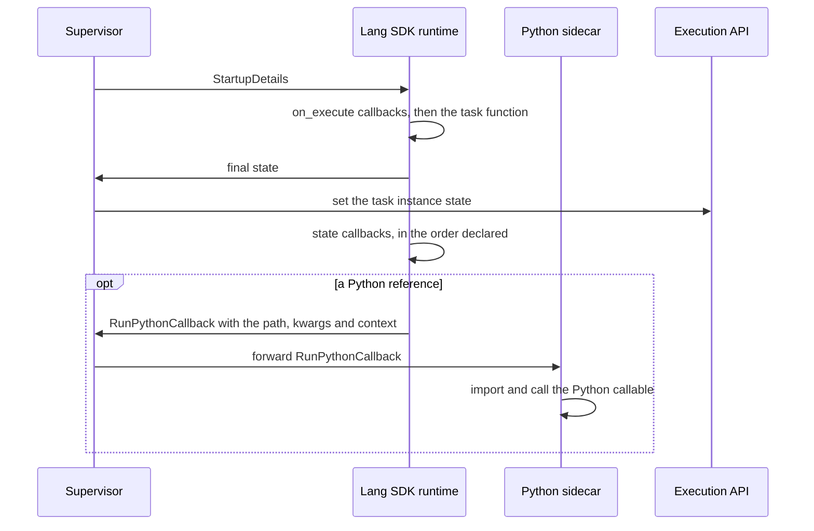
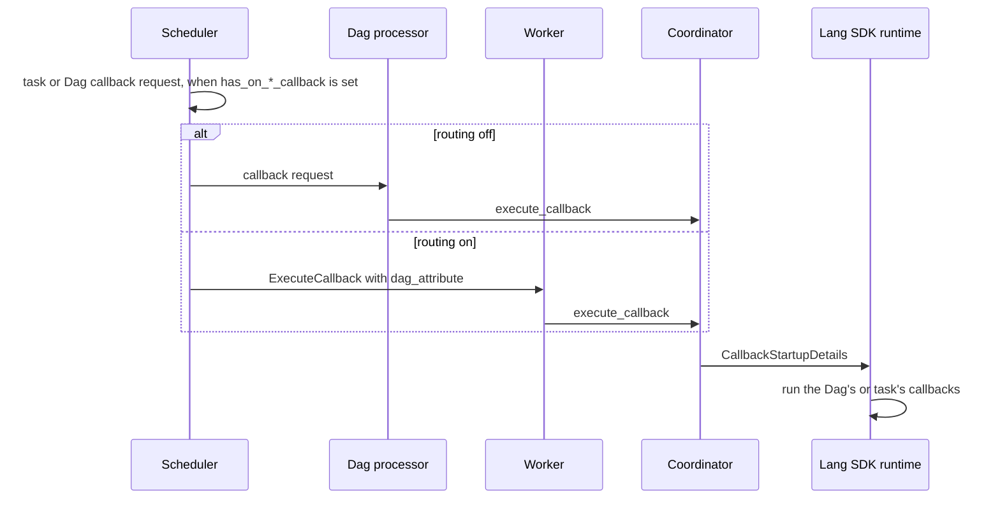
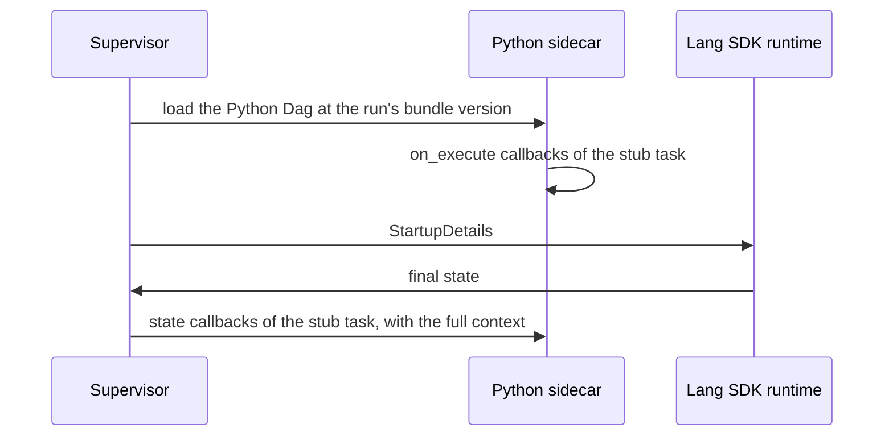
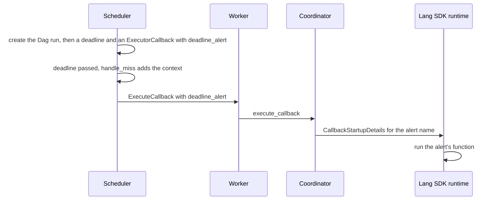
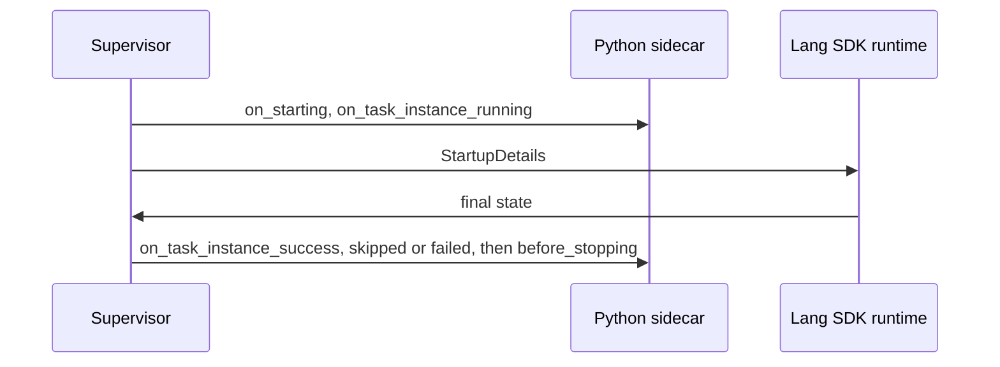

<!--
 Licensed to the Apache Software Foundation (ASF) under one
 or more contributor license agreements.  See the NOTICE file
 distributed with this work for additional information
 regarding copyright ownership.  The ASF licenses this file
 to you under the Apache License, Version 2.0 (the
 "License"); you may not use this file except in compliance
 with the License.  You may obtain a copy of the License at

   http://www.apache.org/licenses/LICENSE-2.0

 Unless required by applicable law or agreed to in writing,
 software distributed under the License is distributed on an
 "AS IS" BASIS, WITHOUT WARRANTIES OR CONDITIONS OF ANY
 KIND, either express or implied.  See the License for the
 specific language governing permissions and limitations
 under the License.
 -->

# ADR-0020: Callbacks, Deadline Alerts and Listeners Across Lang SDKs

## Status

Proposed.

## Context

A Lang SDK Dag has no callbacks today. No SDK writes the `has_on_*_callback` flags, the Dag
processor manager drops every callback request for a file a Lang SDK importer claims, and
[#76303](https://github.com/apache/airflow/pull/76303), which routes Dag processor callbacks to
executors, fails them for a Lang SDK Dag. A stub TaskHandler's callbacks fire only when the Dag
processor runs them, since the Python task runner's `finalize()` never runs for it. Task instance
listener hooks never fire for a Lang SDK task for the same reason. Deadline alerts cannot be
authored in a Lang SDK.

This ADR fixes the contract every SDK shares. Each SDK records its own spelling in its own ADR:
[TypeScript](../../../ts-sdk/adr/0005-callbacks-and-deadline-alerts-authoring-interface.md),
[Go](../../../go-sdk/adr/0011-callbacks-and-deadline-alerts-authoring-interface.md) and
[Java](../../../java-sdk/adr/0005-callbacks-and-deadline-alerts-authoring-interface.md).

## Decision

1. **A callback is an SDK function or a Python reference.** A Python reference is
   `python.callbackRef(path, kwargs)` from the `python` module that ADR-0019, assets and timetables
   across Lang SDKs, adds. A callback list can mix both and runs
   in the order declared. An exception in a callback is logged and swallowed, as in Python.
2. **An SDK writes only the existing callback flags.** It sets `has_on_success_callback` and
   `has_on_failure_callback` on the Dag and `has_on_{execute,success,failure,retry,skipped}_callback`
   on a task, since the scheduler creates a callback request only when the flag is set. No new
   serialized field is added. The callables stay in the runtime, which loads them from its own Dag
   definition. A stub TaskHandler's callables stay in its Python Dag file.
3. **A coordinator launches a callback the way it launches a task.** `BaseCoordinator` keeps
   `execute_task` and gains `execute_callback`. Both start the runtime with the same process, comms
   channel and Python sidecar; only the first message differs: `StartupDetails` or the new
   `CallbackStartupDetails`, which names the kind (task, Dag or deadline), the callback type, the
   Dag, the task or alert, and the callback context. A task callback uses the coordinator of the
   task instance's queue. A Dag or deadline callback uses the coordinator whose Dag importer claims
   the Dag file.
4. **The runtime runs a task's callbacks when the task ends.** A task ends when the runtime reports
   its final state. A task dies when its process stops before that, and the scheduler finds it by
   its heartbeat. `on_execute_callback` runs before the task function. The state callbacks run after
   the runtime reports the final state, as Python's `finalize()` does. For a Python reference the
   runtime sends the new `RunPythonCallback` message (path, kwargs and context) to the supervisor,
   which forwards it to the Python sidecar. The sidecar imports and calls the callable, so no user
   code runs in the supervisor.
5. **Every other callback goes through `execute_callback`.** For a task that died, and for Dag
   success and failure, the scheduler sends the same requests it sends for a Python Dag. Both the
   Dag processor (routing off) and the worker (routing on, `dag_attribute`) call
   `execute_callback` for a Lang SDK Dag instead of dropping or failing the request. The runtime
   reads the callback context through the Execution API, as #76303 does for Python.
6. **The Python sidecar runs a stub TaskHandler's callbacks.** When the task ends, the sidecar loads
   the Python Dag at the run's bundle version and `dag_rel_path`, as #76303's
   `dag_attribute_callbacks` does, finds the stub task and runs its callbacks with the full template
   context: `on_execute_callback` before the runtime starts, the state callbacks after it reports.
   Callbacks for a dead task and Dag callbacks are unchanged, since the Dag file is Python.
7. **Each kind of callback gets its own context.** An SDK function gets the SDK's
   `CallbackContext`: the Dag run, the task instance for a task callback, the error for a failure or
   retry callback, the reason for a Dag callback, the deadline for a deadline callback, and the
   source. A Python reference in a Lang SDK Dag gets the Python template context the sidecar can
   build without a Python task: `ti`, `dag_run`, `run_id`, `logical_date`, `exception` and
   `callback`, but no `task`, `dag` or `params`.
8. **A deadline alert takes a built-in reference or a Python reference.** The built-in references
   are Dag run logical date, Dag run queued at, fixed datetime and average runtime. A custom
   reference is `python.deadlineReferenceRef(path, data)`, where `path` names a class a plugin
   registers in `deadline_references` and `data` is what its `deserialize_reference()` reads. The
   Lang SDK Dag processor rebuilds the reference with that class and stores what
   `encode_deadline_reference` writes, so the stored form matches a Python Dag's. An unregistered
   class is an import error.
9. **A deadline callback is sync or async.** A sync callback is an SDK function or
   `python.callbackRef`. An async callback is `python.asyncCallbackRef(path, kwargs, queue)`, which
   runs as a trigger in the triggerer, so it must be Python, and every SDK rejects an SDK function
   there at build time. A Python reference serializes as the existing `SyncCallback` or
   `AsyncCallback`, and runs as it does for a Python Dag.
10. **The alert's name identifies an SDK function used as a deadline callback.** The alert must have a
    name unique in its Dag. Its callback serializes as a new `DeadlineAlertCallback`
    (`{kwargs, executor}`), which `create_from_sdk_def` turns into an `ExecutorCallback` with the
    new fetch method `deadline_alert` and `data = {dag_id, deadline_alert_name, kwargs, executor}`.
    The scheduler queues it like an `import_path` callback, outside #76303's routing rules for
    `dag_attribute`. The worker calls `execute_callback`, and the runtime runs the alert's function.
11. **Listeners stay Python.** An SDK has no listener API. For a Lang SDK task the supervisor fires
    the task instance hooks (`on_starting`, `on_task_instance_running`, `on_task_instance_success`,
    `on_task_instance_skipped`, `on_task_instance_failed`, `before_stopping`) in the Python sidecar,
    with a `RuntimeTaskInstance` whose task is a placeholder carrying the task's ids and queue. For a
    stub TaskHandler the task is the stub from the Python Dag. Dag run, asset and import error hooks
    already fire in the scheduler, API server and Dag processor.
12. **Some features stay unsupported for now**: an SDK function as an async deadline callback, a
    listener written in a Lang SDK, and the failure and retry emails that `email_on_failure` and
    `email_on_retry` send.

## Flows

A task end in a Lang SDK Dag.

A dead task, or Dag success or failure.

A task end for a stub TaskHandler.

A deadline alert with an SDK function.

Listener hooks for a Lang SDK task.

## Consequences

- The core changes are:
  - `BaseCoordinator.execute_callback`, and `CallbackStartupDetails` and `RunPythonCallback` in the
    supervisor schema, which each SDK regenerates;
  - the Dag processor manager and `dag_attribute_callbacks` call `execute_callback` for a Lang SDK
    Dag instead of dropping or failing the request;
  - the `deadline_alert` fetch method, `DeadlineAlertCallback` and its `create_from_sdk_def` case;
  - the Lang SDK Dag processor rebuilds custom deadline references with their plugin class;
  - the Python sidecar runs Python callback references, a stub TaskHandler's callbacks and the task
    instance listener hooks.
- This builds on #76303 and on the Python sidecar process of ADR-0019.
- Each SDK's `capabilities.yaml` marks listeners as supported through Python listeners.
- OpenLineage sends task START and COMPLETE events for a Lang SDK task, without the facets an
  operator's extractor would add.
- A Python reference in a Lang SDK Dag cannot read `task`, `dag` or `params` from its context.
