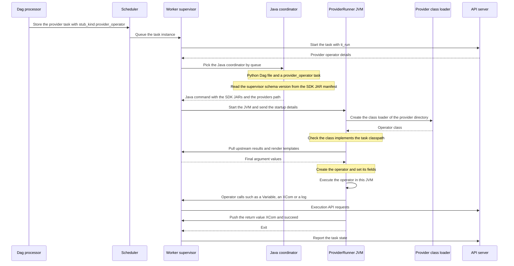
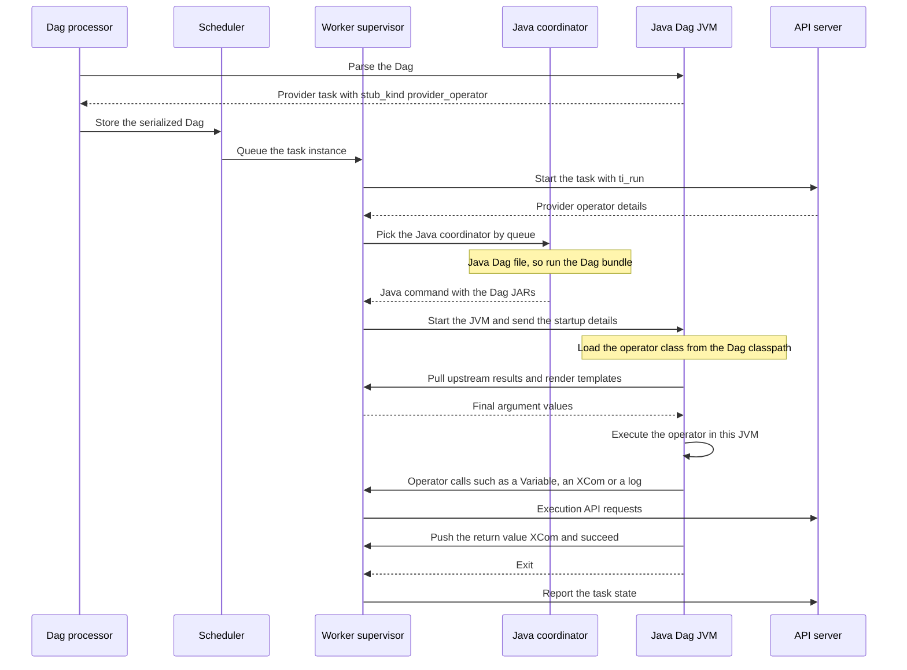

<!--
 Licensed to the Apache Software Foundation (ASF) under one
 or more contributor license agreements.  See the NOTICE file
 distributed with this work for additional information
 regarding copyright ownership.  The ASF licenses this file
 to you under the Apache License, Version 2.0 (the
 "License"); you may not use this file except in compliance
 with the License.  You may obtain a copy of the License at

   http://www.apache.org/licenses/LICENSE-2.0

 Unless required by applicable law or agreed to in writing,
 software distributed under the License is distributed on an
 "AS IS" BASIS, WITHOUT WARRANTIES OR CONDITIONS OF ANY
 KIND, either express or implied.  See the License for the
 specific language governing permissions and limitations
 under the License.
 -->

# provider

Package `org.apache.airflow.sdk.provider` defines provider operators in Java with `@ProviderOperator` and
`@Param`, and adds them to a Dag with `OperatorTask.useOperator`. A task runs the same operator in one of two
ways, picked by the Java coordinator:

- A task of a Java Dag runs in the Dag's own JVM, which has the provider's JAR on its classpath.
- A task of a Dag in another language, such as Python, runs in the generic `org.apache.airflow.sdk.ProviderRunner`,
  which loads the provider's JARs in a class loader of their own.

## Layout of `java_providers_path`

```
<java_providers_path>/
├── sdk/
│   └── airflow-sdk-1.0.0.jar
└── java-localfile/
    └── airflow-provider-java-localfile-1.0.0.jar
```

A task's `_operator_module` is `<provider directory>/<class name>`, such as
`java-localfile/org.apache.airflow.providers.localfile.CreateFileOperator`. Each provider directory gets one
class loader whose parent has the SDK, so providers share the SDK's classes and keep their other dependencies
apart.

## Python Dag using a Java provider



## Java Dag using a Java provider


